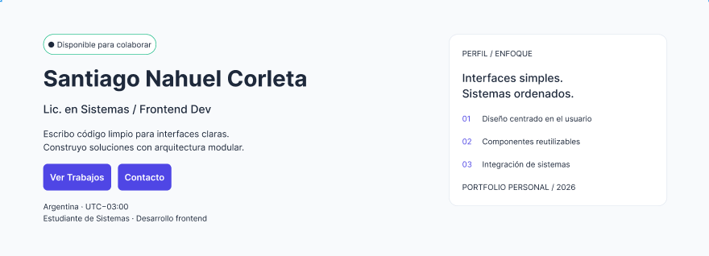
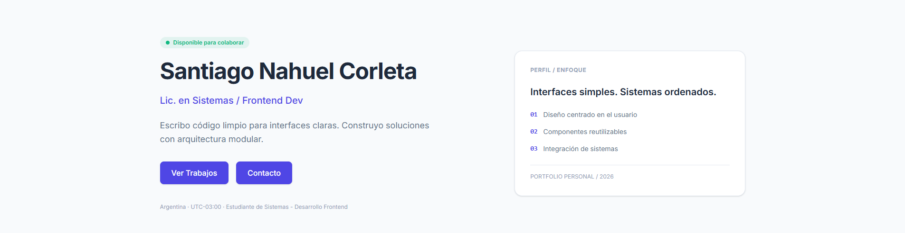
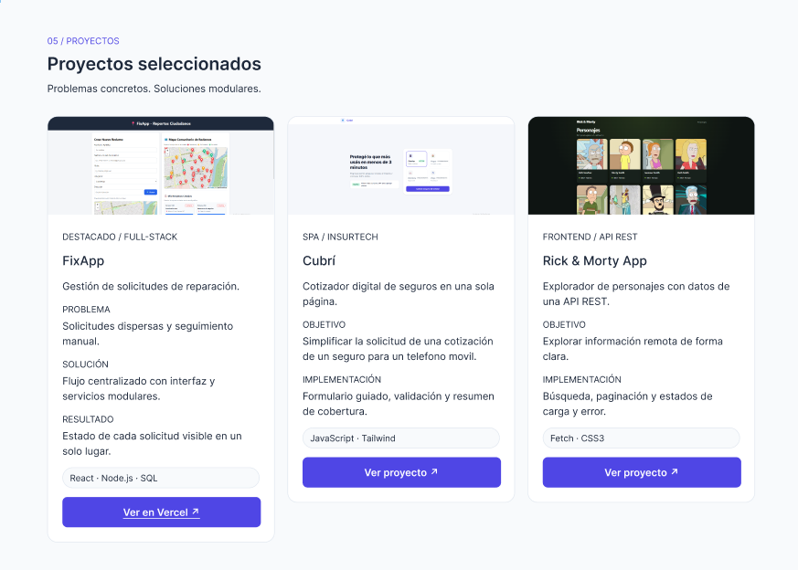
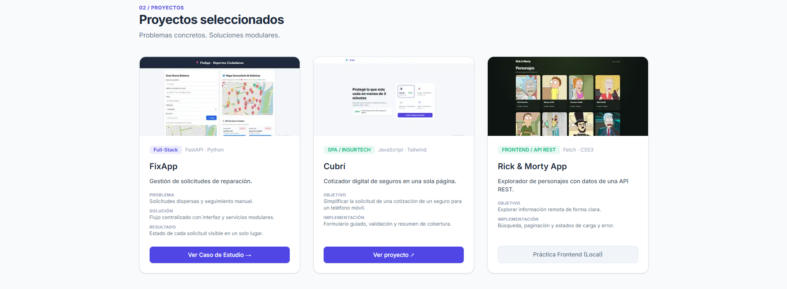
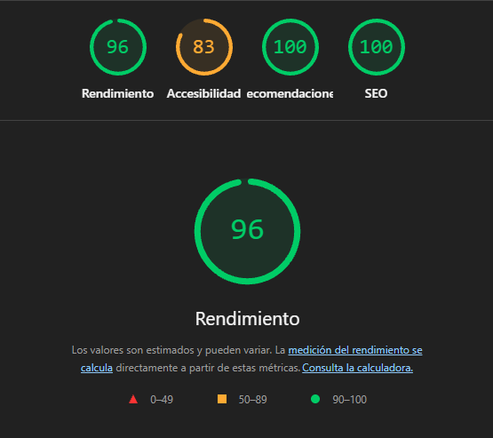

# 🌐 Portfolio Web Personal — Trabajo Final UX/UI

Portfolio web personal desarrollado como trabajo final para la materia **Diseño UX/UI** de la Licenciatura en Sistemas de Información (UADER - FCyT).

## 🔗 Enlaces del Proyecto
- **Sitio en vivo (Deploy):** [Ver Portfolio Desplegado](https://portfoliosantiagocorleta.netlify.app/)
- **Prototipo en Figma:** [Ver Archivo de Figma (Wireframes y Design System)](https://www.figma.com/design/4PZSjnZQt9N8sy1aMEeANI/TP-Final-Dise%C3%B1o-UX-UI?node-id=0-1&t=4UUly0QGOXkHnad8-1)

## 🛠️ Stack Tecnológico
- **Estructura:** HTML5 Semántico.
- **Estilos:** Tailwind CSS (v4).
- **Control de Versiones:** Git y GitHub (con historial incremental de commits).
- **Despliegue:** Vercel.

---

## 📐 Fidelidad de Implementación (Figma vs. Sitio Web)
Comparativa lado a lado entre el diseño prototipado en Figma y la maquetación final en vivo:

### 1. Sección Hero & Presentación
| Prototipo en Figma | Sitio Web Desplegado |
|  |  |

### 2. Sección Proyectos Destacados (Casos de Estudio)
| Prototipo en Figma | Sitio Web Desplegado |
|  |  |

---

## 📊 Auditoría de Rendimiento (Lighthouse Mobile)
Evaluación en versión móvil con puntajes >= 90 en Rendimiento, Recomendaciones y SEO:
Evaluación en versión móvil con puntajes > 80 en Accesibilidad:

---

## 🤖 Declaración sobre el uso de Inteligencia Artificial (IA)
En cumplimiento con la política de uso transparente de IA de la materia:
- **Generación y Asistencia:** Se utilizó IA (Gemini) como asistente en la optimización de sintaxis CSS/Tailwind v4, estructuración de metadatos SEO/ARIA para accesibilidad WCAG.
- **Revisión y Validación:** Todo el código HTML/CSS, enlaces, atributos semánticos y componentes generados fueron revisados, probados localmente y auditados mediante dev tools y Lighthouse por el autor antes de ser integrados al repositorio.

---

## 📄 Créditos, Recursos y Proceso de Deploy
- **Proceso de Deploy:** Integración continua mediante GitHub conectado a **Netlify** para despliegue automático tras cada `push` a la rama principal.
- **Tipografía:** Google Fonts (*Inter*).
- **Activos de Imagen:** Optimización de activos PNG/JPG a formato WebP (`logo.webp`, `perfil.webp`, `mockups.webp`).

---
Desarrollado por **Santiago Nahuel Corleta** (2026).